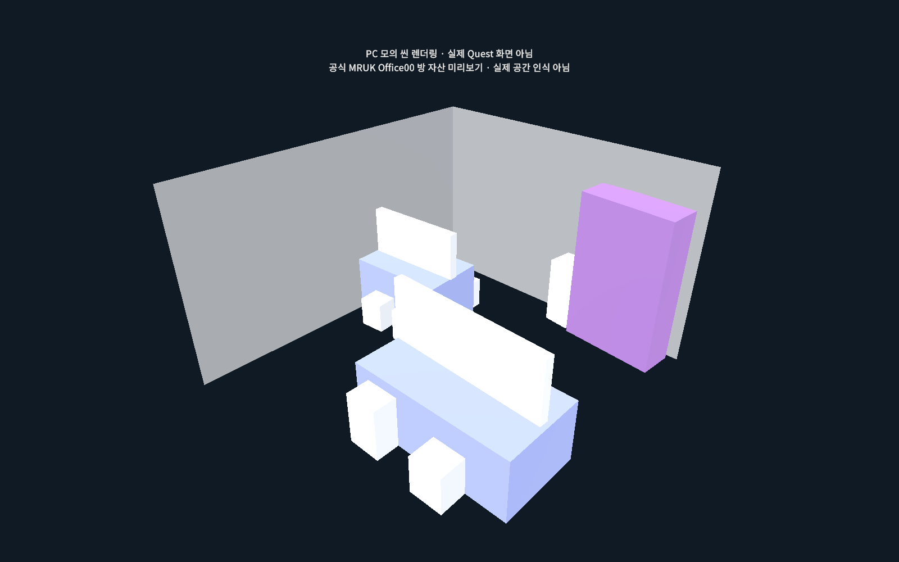
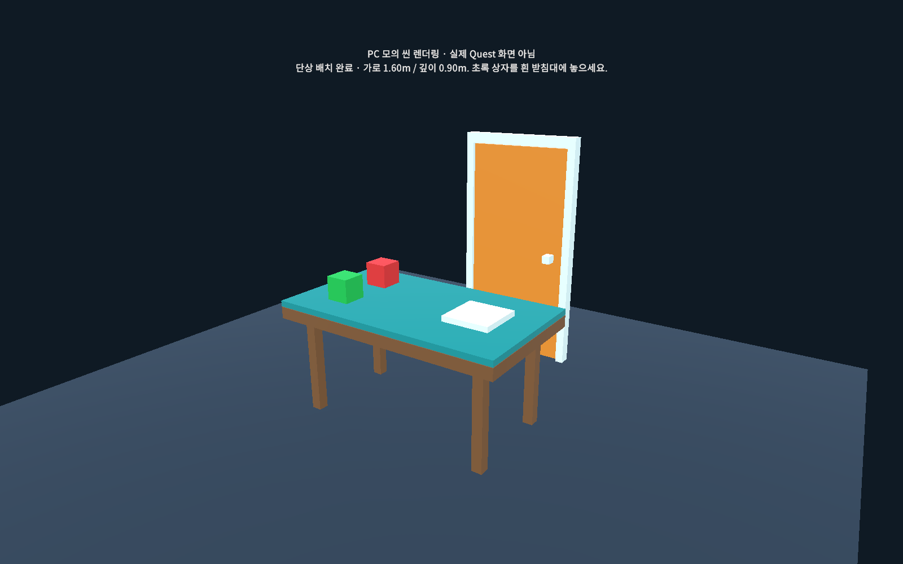
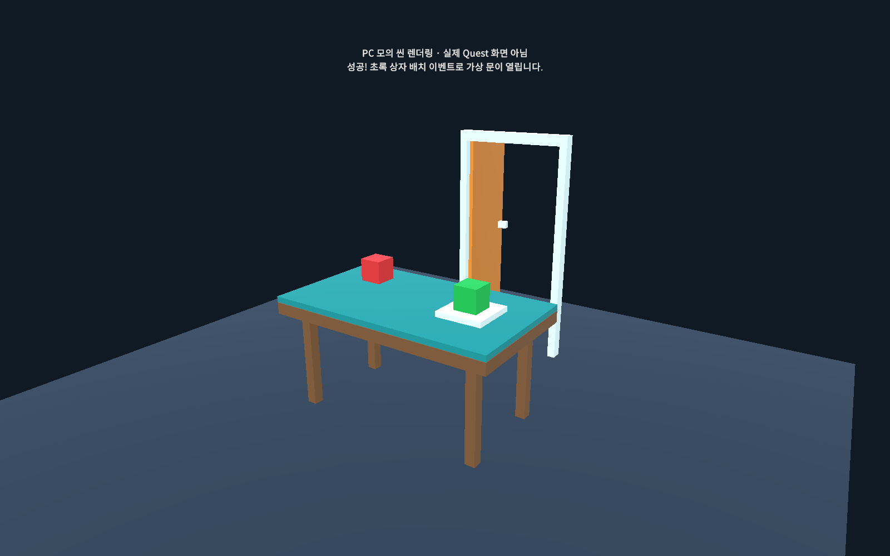

# MY_VR

Unity XR 초보자를 위한 VR·MR 실습 프로젝트입니다. 준비된 씬과 소품으로 **무대 꾸미기 → 책상 위치에 단상 맞추기 → 두 사람이 협동해 문 공개하기**를 차례로 연습합니다.

PC에서는 모의 입력으로 동작을 익히고, Quest에서는 실제 공간 정보와 컨트롤러를 사용하는 구성을 제공합니다. **MR·협동 실습의 PC 검증 기록은 있으며, Quest 기기 동작은 추가 검증이 필요합니다.**

## 1. 무엇을 만들나요?

| 실습 | 여는 씬 | 최종 결과 |
| --- | --- | --- |
| 기본 VR 템플릿 | [SampleScene](Assets/Scenes/SampleScene.unity) | 기본 XR 상호작용 살펴보기 |
| 1회차 · VR 무대 꾸미기 | [StageDecorating](Assets/XRStageTextbook/StageDecorating.unity) | 상자·의자·테이블을 잡고 옮겨 무대 꾸미기, 순간이동과 소켓 배치 연습 |
| 2회차 · MR 공간 예시 | [MR_RoomPreview](Assets/MR_TEST/Scenes/MR_RoomPreview.unity) | 공식 MRUK Office00 방 프리팹으로 공간 데이터의 형태 이해하기 |
| 2회차 · MR 책상과 이벤트 | [MR_TableEvent](Assets/MR_TEST/Scenes/MR_TableEvent.unity) | 책상 크기에 단상을 맞추고, 정답 상자를 놓으면 가상 문 열기 |
| 3회차 · 협동 문 실습 | [DoorMeet](Assets/Session3_DoorMeet/Scenes/DoorMeet.unity) | 두 사람이 각자 미션을 풀면 실제 문 위치를 패스스루로 공개하기 |

휴대폰 AR 수업은 **별도 프로젝트 `E:\Unity\AR`**에서 진행합니다. 이 저장소의 `Assets/AR`에는 이전 Editor 보조 코드만 남아 있으며, 실행할 AR 수업 씬은 없습니다.

## 2. 개발 환경

2026-10-22에 확인한 프로젝트 파일 기준입니다. 다른 버전으로 자동 업그레이드하기보다 아래 Editor 버전으로 먼저 여는 것을 권장합니다.

| 항목 | 버전 |
| --- | --- |
| Unity Editor | **6000.3.25f1 · Unity 6.3** |
| Universal Render Pipeline | 17.3.0 |
| XR Interaction Toolkit · XRI | 3.5.1 |
| Input System | 1.20.0 |
| OpenXR Plugin | 1.17.1 |
| Unity OpenXR: Meta | 2.5.1 |
| XR Hands | 1.8.1 |
| Meta XR Core SDK / MR Utility Kit · MRUK | 각각 207.0.0 |
| Netcode for GameObjects | 2.7.0 |
| AR Foundation / ARCore XR Plugin | 각각 6.5.0 |

정확한 의존성은 [manifest.json](Packages/manifest.json), Editor 버전은 [ProjectVersion.txt](ProjectSettings/ProjectVersion.txt)에 기록돼 있습니다. Meta 패키지용 Scoped Registry도 manifest에 포함돼 있습니다.

## 3. 처음 프로젝트 열기

1. Unity Hub에서 **Installs**를 열고 `6000.3.25f1`을 설치합니다. Quest 빌드를 할 때는 해당 Editor의 **Android Build Support / Android SDK & NDK Tools / OpenJDK**도 준비합니다.
2. Hub의 **Projects > Add > Add project from disk**에서 프로젝트 최상위 폴더를 선택합니다. 현재 PC 경로는 `E:\Unity\MY_VR`입니다.
3. 선택할 폴더 안에 `Assets`, `Packages`, `ProjectSettings`가 모두 있는지 확인합니다. `Assets`만 선택하지 않습니다.
4. 프로젝트를 열고 패키지 복원과 가져오기가 끝날 때까지 기다립니다. 처음 열 때는 인터넷 연결이 필요합니다.
5. **Window > General > Console**에서 빨간 오류가 없는지 확인합니다.
6. 아래에서 원하는 씬을 열어 실습합니다. 씬을 바꿀 때는 먼저 상단 **Play**를 끕니다.

저장소를 내려받았다면 `Library`가 없어도 정상입니다. Unity가 다시 만듭니다. `Builds`의 PC 프로그램과 배포 패키지는 Git에서 제외되어 있으므로 별도 전달본이 있어야 실행할 수 있습니다.

## 4. 1회차 — VR 무대 꾸미기

1. Project 창에서 **Assets > XRStageTextbook > StageDecorating**을 더블클릭합니다.
2. Hierarchy에서 `Environment`, `Props`, XR Rig가 있는지 확인합니다. 무대와 왼쪽 소품 준비 구역이 보이면 준비된 씬입니다.
3. 상단 **Play**를 누르고 **Game** 창을 클릭합니다.
4. PC에서는 자동 생성되는 **XR Interaction Simulator**의 화면 조작 안내를 보며 시점과 컨트롤러를 조작합니다. 일반 Scene 창 이동과는 조작이 다릅니다.
5. 준비 구역의 상자·의자·테이블·장식물을 잡아 무대로 옮겨 놓습니다.
6. 바닥 또는 무대를 대상으로 순간이동하고, 무대 위 청록색 배치 표시에 소품을 가까이 놓아 소켓 동작을 확인합니다.
7. Play를 끈 뒤 소품 프리팹의 `GrabPoint`와 XR Grab Interactable의 `Attach Transform`을 살펴보며 잡는 기준점을 확인합니다.

**기대 결과:** 무대 주변을 이동하고, 소품을 잡고 놓으며 배치를 바꿀 수 있습니다. Play 중 바꾼 배치는 일반적으로 Play 종료 후 원래 상태로 돌아옵니다. 장면 편집과 실행 중 조작을 구분해 연습하세요.

준비된 소품은 [Prefabs](Assets/XRStageTextbook/Prefabs)에 있습니다. 처음부터 잡기 코드를 작성할 필요 없이 이 프리팹과 XRI 구성을 살펴보면 됩니다.

## 5. 2회차 — MR 책상과 이벤트

### PC에서 먼저 해보기

1. 상단 **MR 실습 > 1. 공간 예시 열기**를 선택합니다.
2. Play를 누르고 Game에서 방 구조를 살펴봅니다. 이 방은 **공식 MRUK의 Office00 프리팹**이며, PC 주변을 스캔한 결과가 아닙니다.
3. Play를 끄고 **MR 실습 > 2. 책상과 이벤트 열기**를 선택합니다.
4. 다시 Play를 누르고 **모의 책상에 단상 맞추기**를 누릅니다. 가로 `1.60m`, 깊이 `0.90m`, 상판 높이 `0.75m`인 모의 책상에 단상이 맞춰집니다.
5. **빨간 상자 올리기 · 오답**을 누릅니다. 문이 닫혀 있어야 합니다.
6. **초록 상자 올리기 · 정답**을 누릅니다. 흰 받침대 위에 상자가 안정되면 주황색 가상 문이 열립니다.
7. **처음 상태로**를 눌러 소품과 문을 초기화합니다.

**성공 조건:** 정답인 초록 상자를 흰 받침대 안에 놓고 손을 떼어 안정시켜야 합니다. 잡고 있거나, 공중에 떠 있거나, 받침대 밖에 있으면 완료되지 않습니다. PC 버튼은 Quest의 잡고 놓기를 대신하는 모의 입력입니다.

| 공간 예시 | 책상에 단상 맞춤 | 정답으로 문 열림 |
| --- | --- | --- |
|  |  |  |

위 이미지는 Unity 씬 카메라로 렌더링한 **PC 모의 공간**입니다. Quest 패스스루 촬영이나 실제 프로그램 창 캡처가 아닙니다.

### 준비된 PC 프로그램 사용하기

별도 전달받은 `Builds/MR_PC` 폴더에서 `StartPractice.cmd`를 실행합니다. 공간 예시는 `StartRoomPreview.cmd`로 엽니다. `MR_Practice.exe`만 옮기지 말고 데이터 폴더가 포함된 **MR_PC 폴더 전체**를 전달합니다.

새로 만들 때는 **MR 실습 > 3. PC 연습 프로그램 만들기**를 사용합니다. 실습 패키지는 **MR 실습 > 5. 실습 패키지 내보내기**로 내보냅니다. 현재 로컬에는 `Builds/MR-TablePractice.unitypackage`가 있으며, Git에는 포함되지 않습니다.

### Quest에서 확인할 흐름

기기 실행은 PC 모의 실습과 별도로 확인해야 합니다.

1. Quest 시스템의 공간 설정에서 방과 책상 **TABLE**을 등록합니다.
2. Unity에서 **MR 실습 > 4. Quest 공간·패스스루 설정 준비**를 선택합니다. 프로젝트 공통 Meta 설정이 변경되는 메뉴입니다.
3. Android OpenXR·Meta XR 기능과 컨트롤러 프로파일을 확인하고 Meta의 Project Setup Tool에서 설정을 검토합니다.
4. 아래 빌드 안내에 따라 `MR_TableEvent`를 실행 씬으로 선택해 Quest용 빌드를 준비합니다.
5. 기기에서 공간 정보 접근 권한을 허용합니다. 현재 방의 유효한 TABLE 중 가장 큰 책상의 중심·크기·방향을 사용합니다.
6. 가상 초록 상자를 컨트롤러 그립으로 잡아 흰 받침대 위에 놓습니다.
7. 오른손 **A**로 초기화하고, **B**로 저장된 공간 정보를 다시 읽습니다.

등록된 TABLE이 없으면 실제 모드에서는 콘텐츠를 숨기고 안내합니다. 실물 책상을 옮겼다면 시스템 공간 설정을 갱신해야 합니다. B 버튼은 저장된 정보를 다시 읽으며 새 스캔을 수행하지 않습니다.

이 실습은 **고정된 책상의 등록 위치·크기에 가상 단상을 맞추는 기능**입니다. 실물 상자 인식, 움직이는 책상 추적, 실제 문 자동 제어는 구현 범위에 포함되지 않습니다. Quest 2/3에서 공간 설정·패스스루·잡기 동작은 기기 검증이 필요합니다.

자세한 안내: [MR 실습 설명](Assets/MR_TEST/Documentation/README.txt)

## 6. 3회차 — 두 사람이 미션을 풀고 만나기

실제 문 양쪽의 인접한 공간에서 A는 암호를 입력하고, B는 정답 열쇠를 받침대에 놓습니다. 서로의 힌트를 말로 전달하고 두 미션을 모두 해결하면 실제 문 위치에 맞춘 영역을 패스스루로 공개합니다. 실제 문은 사람이 직접 열고, 상대의 실제 모습은 패스스루로 봅니다.

### 같은 PC에서 두 창으로 연습하기

1. 별도 전달본의 `Builds/Session3_DoorMeet_PC/StartTwoPlayers.cmd`를 실행합니다.
2. 첫 창의 **① 연결 > A · 방 만들기**를 누릅니다.
3. 둘째 창에서 **PC 테스트 주소: 127.0.0.1 > B · 참가하기**를 누릅니다.
4. 두 창 모두 **③ 공간 맞춤 > 문·책상 위치 확인 완료**를 누릅니다.
5. 두 창 모두 **② 미션 > 준비**를 누릅니다.
6. B의 힌트를 보고 A가 암호 **314**를 입력해 제출합니다.
7. A의 힌트를 보고 B가 **파란 열쇠**를 선택해 받침대에 놓습니다.
8. 두 미션이 완료되면 모의 문 패널이 사라지고 상대 표시가 나타납니다.
9. A가 **처음부터 다시**를 누르면 양쪽 진행이 초기화됩니다.

PC에서는 모의 방과 상대 표시를 사용합니다. Editor 씬은 **Session 3 Door Meet > 1. Open or Create Scene**으로 열 수 있습니다. 새 PC 프로그램은 **Session 3 Door Meet > 3. Build Windows PC Verification**으로 만듭니다.

### 실제 Quest 두 대로 확장하기

| 항목 | 구성 |
| --- | --- |
| 검토 대상 기기 | Quest 3 또는 3S 두 대. Quest 2는 이 실습의 검증 대상으로 확정되지 않음 |
| 연결 방식 | 같은 Wi-Fi에서 한 기기가 Host, 다른 기기가 방장 IPv4를 입력해 참가 |
| 통신 | UDP `7779`, 최대 2명. 별도 외부 서버 계정 없이 구성 |
| 공간 정렬 | 각 기기의 MRUK 데이터로 자기 방의 문틀·책상 정렬 |
| 필요한 공간 등록 | 바닥·벽·TABLE·DOORFRAME |
| 기기 메뉴 | 왼손 X로 메뉴 표시/숨김, 오른손 B로 현실 전체 보기 |

**Session 3 Door Meet > 2. Configure Quest Features (no build)**에서 공통 Android 기능을 준비한 뒤 `DoorMeet` 씬을 빌드 대상으로 선택합니다. 각 기기에서 문틀을 선택하고 실제 문·손잡이와 흰 프레임이 맞는지 확인한 다음 준비합니다. 이 실습은 TABLE이 없으면 모의 받침대가 남으므로, 실제 위치를 사용하는 수업에서는 책상을 등록해야 합니다.

문 가까이 약 `1.2m` 안에서는 전체 현실 보기로 전환하고, 약 `1.7m` 밖으로 나가면 문 공개 보기로 돌아옵니다. 실제 공간 정렬, 공개 영역, 이동 동선은 Quest 두 대에서 추가 확인해야 합니다.

동기화하는 항목은 준비·미션 결과·문 공개·초기화 상태입니다. 공유 공간 앵커, 네트워크 아바타, 인터넷 매칭, 음성 채팅, 실제 문 각도 감지, 사람 인식은 포함되지 않습니다. 연결이 끊기면 진행과 문 공개 상태를 해제합니다.

자세한 안내: [협동 문 실습 설명](Assets/Session3_DoorMeet/Documentation/README.txt)

## 7. Quest 빌드 전에 확인하기

현재 [EditorBuildSettings.asset](ProjectSettings/EditorBuildSettings.asset)에서는 **기본 SampleScene만 활성화**되어 있습니다. MR 씬과 DoorMeet은 비활성 항목이며 StageDecorating은 목록에 없습니다. 씬을 열었다고 자동으로 해당 씬이 빌드되는 것은 아닙니다.

1. Play를 종료하고 **File > Build Profiles**를 엽니다.
2. Android 프로필로 전환하고 **Scene List**에서 이번에 실행할 씬을 추가·체크합니다. 원하는 씬이 첫 실행 씬인지 확인하고 다른 실습 씬의 체크를 해제합니다.
3. **Edit > Project Settings > XR Plug-in Management**의 Android 항목에서 OpenXR와 필요한 Meta 기능을 확인합니다.
4. 사용하는 실습의 Quest 설정 메뉴와 Project Setup Tool을 검토합니다. 이 설정은 프로젝트 공통이므로 수업별 빌드 전에 다시 확인합니다.
5. Android 도구와 기기 개발자 모드·USB 연결을 준비한 뒤 빌드·설치를 진행합니다.

현재 저장된 PC 검증 기록만으로 Quest APK의 빌드·설치·실기 동작이 확인된 것은 아닙니다.

## 8. 문제가 생기면

| 증상 | 확인할 내용 |
| --- | --- |
| 상단 실습 메뉴가 없음 | 패키지 가져오기 완료와 Console의 첫 빨간 오류를 확인합니다. Editor 버전도 확인합니다. |
| 패키지 복원 실패 | 인터넷 연결과 manifest의 Meta Scoped Registry를 확인합니다. 버전을 임의로 섞어 변경하지 않습니다. |
| VR에서 PC 입력이 안 됨 | Game 창을 클릭하고 XR Interaction Simulator 안내를 확인합니다. Project Settings > XR Plug-in Management > XR Interaction Toolkit의 시뮬레이터 자동 생성 설정을 확인합니다. |
| VR 순간이동이 안 됨 | Ground·Stage의 Teleportation Area와 컨트롤러의 Teleport 상호작용 레이어가 맞는지 확인합니다. |
| MR 화면에 실제 방이 안 보임 | PC에서는 모의 공간이 정상입니다. Quest에서는 공간 권한·공간 등록·패스스루 설정을 확인합니다. |
| MR 단상이 안 나타남 | 먼저 책상 맞춤을 수행합니다. Quest에서는 TABLE 등록과 권한을 확인합니다. |
| 초록 상자를 놓아도 문이 안 열림 | 손을 떼고, 흰 받침대 안에 안정적으로 놓였는지 확인합니다. 초기화 후 다시 시도합니다. |
| 협동 연결 실패 | 같은 Wi-Fi, 방장 IPv4, UDP 7779 통신을 확인합니다. 게스트 Wi-Fi의 기기 간 통신 차단도 확인합니다. |
| Quest에서 127.0.0.1로 접속 실패 | 이 주소는 같은 PC의 두 창 실습용입니다. Quest에서는 방장 Quest의 LAN IPv4를 사용합니다. |
| 협동 미션 시작 불가 | 두 사람 연결, 양쪽 문 위치 확인, 양쪽 준비 상태를 확인합니다. |
| APK에서 다른 씬이 열림 | Build Profiles의 Scene List에서 활성 씬과 순서를 확인합니다. |

## 9. 폴더와 검증 기록

```text
Assets/
├─ Scenes/                 기본 VR 템플릿 씬
├─ XRStageTextbook/        1회차 무대 씬·소품 프리팹·촬영 보조 도구
├─ MR_TEST/                2회차 MR 씬·코드·이미지·검증 기록
├─ Session3_DoorMeet/      3회차 협동·공간 정렬·네트워크 코드
├─ Samples/               가져온 Unity 공식 패키지 샘플
├─ AR/                    이전 Editor 보조 코드
└─ XRI/, XR/, Oculus/     XR 관련 설정과 자산
Packages/                 패키지 목록과 잠금 파일
ProjectSettings/          Unity 프로젝트 설정
Builds/                   로컬 실행 파일·배포 패키지, Git 제외
```

| 기록 | 저장된 결과 |
| --- | --- |
| [MR PC 검증](Assets/MR_TEST/Documentation/PC-test-results.txt) | 책상 형상·배치 조건·물리 배치·문 이벤트·초기화 등 29개 PASS |
| [협동 검증 요약](Assets/Session3_DoorMeet/Documentation/Validation.txt) | 2026-10-12, 별도 Host/Client 프로세스 등 21개 항목 통과 |
| [협동 상세 결과](Assets/Session3_DoorMeet/Documentation/PC-test-results.json) | 준비·정답/오답·동기화·참가 제한·재연결 등의 결과 |

위 표는 저장된 검증 기록을 요약한 것이며 README 작성 시 재실행한 결과는 아닙니다. Quest의 공간 권한·책상/문 정렬·패스스루·컨트롤러 조작과 실제 두 사람 이동은 별도 검증 항목입니다.

## 10. Git 관리와 배포

이 프로젝트는 **Git LFS 없이 일반 Git으로 관리**하도록 `.gitattributes`의 LFS 필터를 해제했습니다. LFS 관련 설정을 임의로 다시 추가하지 않습니다.

- `Assets`와 `.meta`, `Packages`, `ProjectSettings`를 함께 보관합니다. 자산을 옮길 때 `.meta`도 함께 유지합니다.
- `Library`, `Temp`, `Logs`, `Obj`, `UserSettings`, `Builds`는 `.gitignore`에 따라 제외합니다.
- `.apk`, `.aab`, `.unitypackage` 등 배포 산출물은 Git에 포함되지 않습니다. 수강생에게는 별도 전달합니다.
- 실행 프로그램은 `.exe` 하나가 아닌 데이터와 라이브러리가 들어 있는 폴더 전체를 전달합니다.
- 수업용 `.unitypackage`는 별도 Unity 프로젝트가 아닙니다. 대상 프로젝트의 패키지 버전과 공통 XR 설정도 함께 확인합니다.

## 11. 포함 자산과 라이선스

포함된 Unity·Meta 패키지, 샘플, 글꼴에는 각 제공자의 라이선스가 적용됩니다. 이 README는 프로젝트 전체에 새로운 배포 라이선스를 부여하지 않습니다.

- MR 수업의 [Unity XRI 라이선스](Assets/MR_TEST/Documentation/Unity-XRI-LICENSE.txt)와 [서드파티 고지](Assets/MR_TEST/Documentation/Unity-XRI-Third-Party-Notices.txt)를 보존합니다.
- Noto Sans CJK KR 배포 시 [MR 글꼴 OFL](Assets/MR_TEST/Fonts/OFL.txt)과 [협동 실습 글꼴 OFL](Assets/Session3_DoorMeet/Fonts/OFL.txt)을 함께 보존합니다.
- 공식 패키지의 라이선스와 샘플 고지도 배포 구성에 맞춰 확인합니다.
